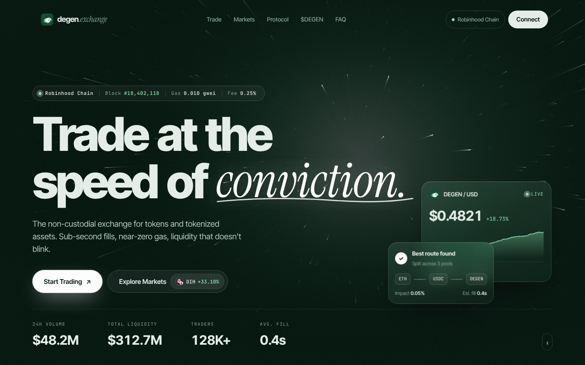

# degen.exchange

A cinematic landing page and swap terminal for a non-custodial DEX on **Robinhood Chain**. Plain HTML/CSS/JS with no build step.



## Run locally

```bash
python3 -m http.server 8080   # or: npx serve .
```

Then open `http://localhost:8080`. You can deploy it as-is to Vercel, Netlify, Cloudflare Pages or GitHub Pages.

## What's inside

- **Intro reveal.** Letterbox bars open with a 00→100 counter.
- **Hero.** A full-screen warp-speed starfield drawn on canvas. It follows the cursor (parallax) and speeds up while you hold the mouse button.
- **Manifesto.** The words light up one by one as you scroll.
- **Terminal.**
  - Live pair chart (1H/1D/1W/1M) with a hover crosshair.
  - Swap card with token picker, flip, slippage, 50%/MAX, quote, price impact and route.
- **Wallet.** Connects through EIP-1193 (MetaMask, Rabby, Robinhood Wallet…). It switches to Robinhood Chain automatically, or adds the network first if the wallet doesn't have it. The ETH balance shown is read from the chain.
- **Markets table.** Search, gainers/losers filters, sparklines, and one-click trade.
- **Other sections:** features with tilt and spotlight cards, how-it-works, $DEGEN token orbit, FAQ, and finale.
- **Polish:** film grain, cursor glow, blur-in scroll reveals, responsive mobile menu.
- **Reduced motion:** `prefers-reduced-motion` is respected.

## Configuration (`app.js`)

- `CHAIN` sets the network parameters. It currently points to Robinhood Chain Testnet (chain ID 46630). Update it for mainnet.
- `ROUTER_ADDRESS` is the DEX router contract. While it is `null`, the Swap button runs in **demo mode** and sends no transaction.
- `TOKENS` holds the token list and its indicative prices. Tokens flagged `meme: true` are Robinhood Chain meme coins (Cash Cat, Artificial Inu, StonkBroker, Little John, Dog in Hood, Tendies, …). They feed the markets table, the ticker and the top mover. Prices are placeholders: replace them with an on-chain or API price feed before going to production.

## Token logos

Each token's icon lives in `assets/tokens/<symbol>.svg`, with `DEGEN` using `assets/logo.svg`. The current meme coin icons are themed artwork built from [Twemoji](https://github.com/jdecked/twemoji) (CC-BY 4.0). They are not the projects' official logos. To use an official logo, save it under the same filename, or set a `logo` URL on the token in `TOKENS`.

> Independent project, not affiliated with Robinhood Markets, Inc.
